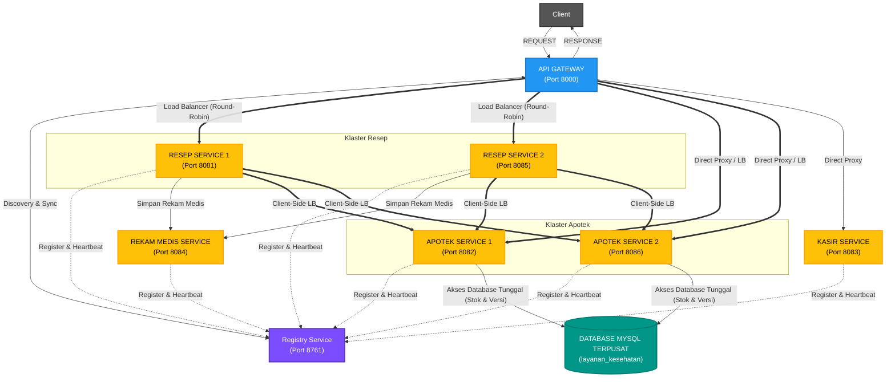
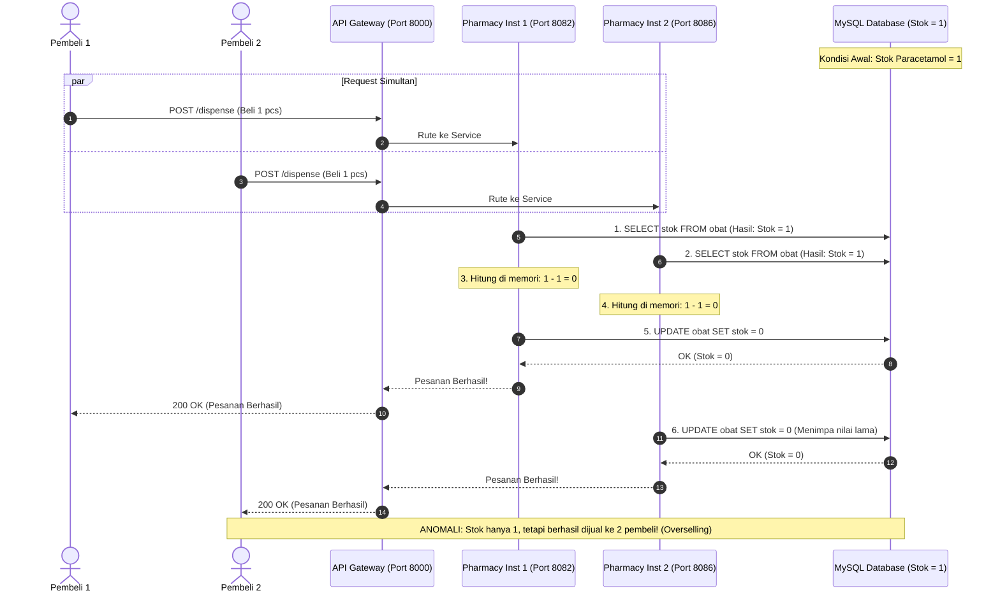
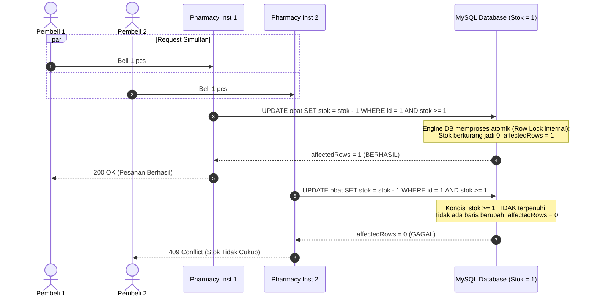
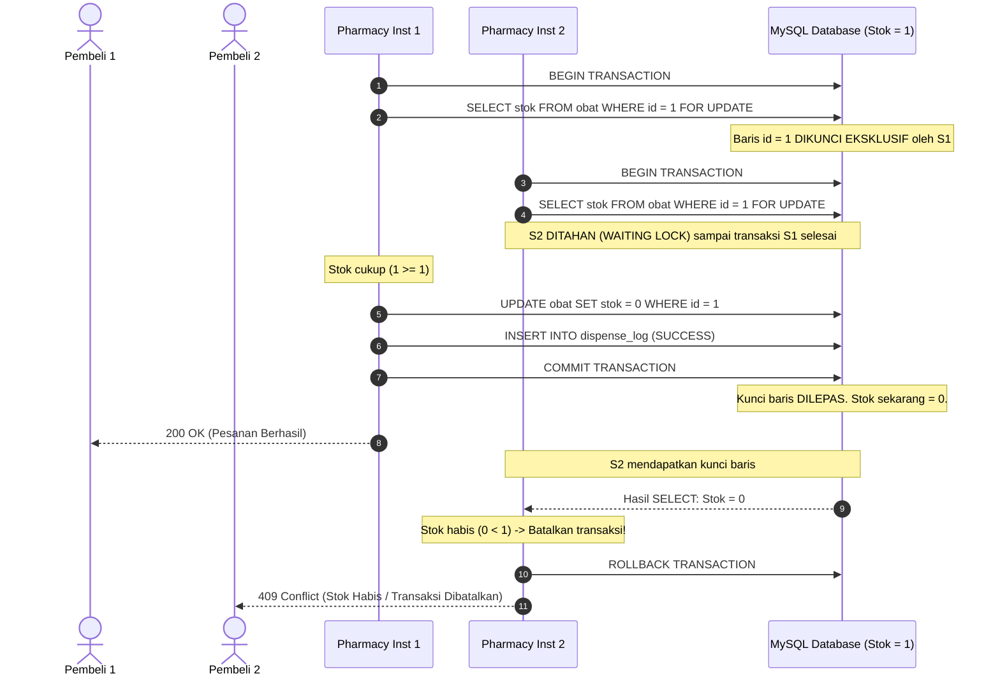
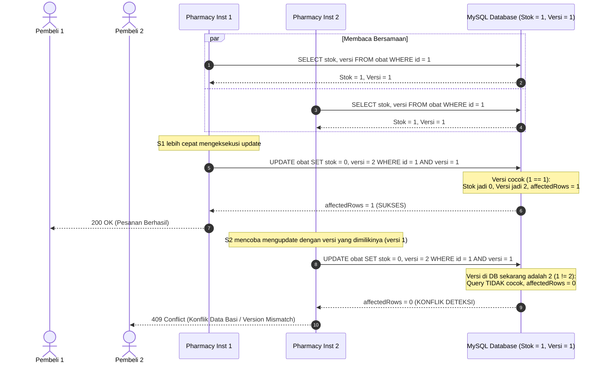

# API Gateway, Service Discovery, Load Balancer & Konsistensi Data (Race Condition) - Sistem Layanan Kesehatan
**Mata Kuliah:** Sistem Terdistribusi  
**Program Studi:** S1 Teknologi Informasi, Fakultas Ilmu Komputer, Universitas Jember  
**Pola Desain & Konsep:**
- API Gateway Pattern & Dynamic Reverse Proxy
- Service Registry & Discovery (Eureka-like) dengan Heartbeat & Auto-Eviction
- Dual-Layer Load Balancer (Native Round-Robin) & Auto-Failover
- Konsistensi Data pada Database Tunggal (Single Shared Database)
- Penanganan Concurrency & Race Condition (*Lost Update / Overselling*):
  1. **Operasi Atomik (*Atomic Operation*)**
  2. **Transaksi Database (*Database Transaction with Row Locking*)**
  3. ***Optimistic Locking* dengan Kolom Versi (*Versioning*)**

---

## 1. Arsitektur Komunikasi, Load Balancer & Database



1. **North-South Traffic (Klien ke Gateway ke Service):**  
   API Gateway mendistribusikan request secara bergantian (*Round-Robin*) ke instance aktif.
2. **East-West Traffic (Service-to-Service):**  
   Prescription Service mencari instance Pharmacy Service via Service Registry dan menyeimbangkan beban antar instance apotek.
3. **Database Bersama (Single Database Concurrency):**  
   Seluruh instance Pharmacy Service mengakses database tunggal yang sama. Ketika beberapa request membeli stok terakhir secara bersamaan, potensi **Race Condition** dapat terjadi jika tidak ditangani dengan benar.

---

## 2. Pemetaan Port & Instance Cluster

| Komponen / Service | Port | Peran |
| :--- | :---: | :--- |
| **Service Registry (Eureka-like)** | **`8761`** | Pusat pendaftaran instance & liveness heartbeat |
| **API Gateway (Load Balancer)** | **`8000`** | Single Point of Entry & Round-Robin Proxy Router |
| **Prescription Service (Instance 1)** | **`8081`** | Pemroses resep & pengorkestrasi antar-layanan |
| **Prescription Service (Instance 2)** | **`8085`** | Penyeimbang beban resep (Horizontal Scaling) |
| **Pharmacy Service (Instance 1)** | **`8082`** | Penyiapan obat & transaksi database (Node 1) |
| **Pharmacy Service (Instance 2)** | **`8086`** | Penyiapan obat & transaksi database (Node 2) |
| **Cashier Service** | **`8083`** | Penerbitan faktur tagihan pembayaran |
| **Medical Record Service** | **`8084`** | Pencatatan arsip rekam medis pasien (EMR) |
| **MySQL Database Server** | **`3306`** | Database relasional terpusat (`layanan_kesehatan`) |

---

## 3. Konfigurasi Lingkungan (`.env`)

Sistem menggunakan file `.env` untuk kredensial database dan konfigurasi jaringan. Contoh isi `.env`:
```env
DB_HOST=localhost
DB_PORT=3306
DB_USER=root
DB_PASSWORD=
DB_NAME=layanan_kesehatan
DB_CONNECTION_LIMIT=10

REGISTRY_URL=http://localhost:8761
GATEWAY_URL=http://localhost:8000
```

---

## 4. Persiapan Database: Migration & Seeder

Pastikan service MySQL di **Laragon / XAMPP** Anda sudah dalam status **Started** (Port 3306).

Jalankan perintah otomatis berikut:
```bash
# 1. Jalankan migrasi dan seeder data awal sekaligus
npm run db:setup
```

Atau secara terpisah:
```bash
# Menjalankan migrasi skema tabel
npm run db:migrate

# Mengisi data master obat awal (Paracetamol stok = 1, versi = 1)
npm run db:seed

# Mereset stok obat untuk simulasi ulang
npm run db:reset
```

---

## 5. Cara Menjalankan Sistem

### Menjalankan Klaster Penuh (Multi-Instance + Load Balancer):
```bash
npm run start:cluster
```
Perintah ini akan menjalankan 8 proses sekaligus:
- Service Registry (8761)
- API Gateway (8000)
- Prescription Service 1 (8081) & 2 (8085)
- Pharmacy Service 1 (8082) & 2 (8086)
- Cashier Service (8083)
- Medical Record Service (8084)

---

## 6. Pengujian & Demonstrasi Tugas

### A. Uji Materi Utama: Race Condition & Solusi Konsistensi Data
Buka terminal baru, jalankan:
```bash
npm run simulate:race
```
Skrip ini akan menembakkan **3 request pembelian serentak** untuk **1 stok terakhir obat Paracetamol** ke 4 skenario berbeda secara berurutan:

1. **Skenario Rentan (*Vulnerable Check-Then-Act*)**:
   - Membuktikan terjadinya **Race Condition / Overselling**.
   - Ketiga request sama-sama membaca stok = 1, sehingga lebih dari 1 transaksi berhasil mendapatkan barang padahal stok hanya 1.
2. **Solusi 1: Operasi Atomik (*Atomic Operation*)**:
   - Menerapkan query:
     ```sql
     UPDATE obat SET stok = stok - 1 WHERE id = 1 AND stok >= 1;
     ```
   - Hanya tepat 1 request yang berhasil (`affectedRows = 1`), sedangkan request lainnya ditolak (`affectedRows = 0`).
3. **Solusi 2: Transaksi Database (*Database Transaction with Row Locking*)**:
   - Menerapkan transaksi ACID:
     ```sql
     START TRANSACTION;
     SELECT id, nama_obat, stok FROM obat WHERE id = 1 FOR UPDATE;
     -- Kurangi stok dan catat pesanan dalam 1 unit atomik
     COMMIT;
     ```
   - Row-locking memastikan transaksi dijalankan secara serial sehingga integritas data terlindungi.
4. **Solusi 3: Optimistic Locking dengan Versi (*Versioning*)**:
   - Menerapkan query conditional update versi:
     ```sql
     UPDATE obat SET stok = stok - 1, versi = versi + 1 WHERE id = 1 AND versi = ?;
     ```
   - Request pertama berhasil meng-increment versi (misal versi 1 -> 2).
   - Request kedua dan ketiga ditolak dengan status **Konflik Versi (*Version Mismatch / Stale Data*)**.

### B. Demonstrasi Load Balancer (Round-Robin & Auto-Failover):
```bash
npm run demo:lb
```
Membuktikan distribusi beban 50:50 antar instance serta toleransi kegagalan saat ada instance yang dimatikan.

### C. Alur Standar Integrasi Antar-Layanan:
```bash
npm run simulate
```
Membuktikan orkestrasi penerbitan resep dokter yang otomatis didistribusikan ke Apotek, Kasir, dan Rekam Medis.


---

## 7. Diagram Alur: Race Condition & 3 Solusi Konsistensi Data

### A. Diagram Terjadinya Race Condition (Lost Update / Overselling)
Pada skenario rentan (*Check-Then-Act*), Service #1 dan Service #2 membaca stok secara bersamaan sebelum ada yang menuliskan perubahan ke database. Keduanya menghitung sisa stok `1 - 1 = 0`, keduanya mengupdate database, dan keduanya mengembalikan status sukses:



---

### B. Diagram Solusi 1: Operasi Atomik (Atomic Operation)
Operasi pengecekan dan pengurangan stok disatukan dalam satu query atomik di level engine database: `UPDATE obat SET stok = stok - 1 WHERE id = 1 AND stok >= 1`.



---

### C. Diagram Solusi 2: Database Transaction (Pessimistic Row Locking)
Menggunakan transaksi ACID dengan klausa `SELECT ... FOR UPDATE` untuk mengunci baris data secara eksklusif.



---

### D. Diagram Solusi 3: Optimistic Locking (Versioning Column)
Menggunakan kolom `versi` sebagai penanda apakah data telah dimodifikasi oleh proses lain saat jeda pembacaan dan penyimpanan.


